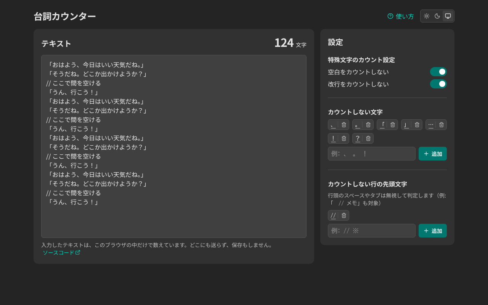
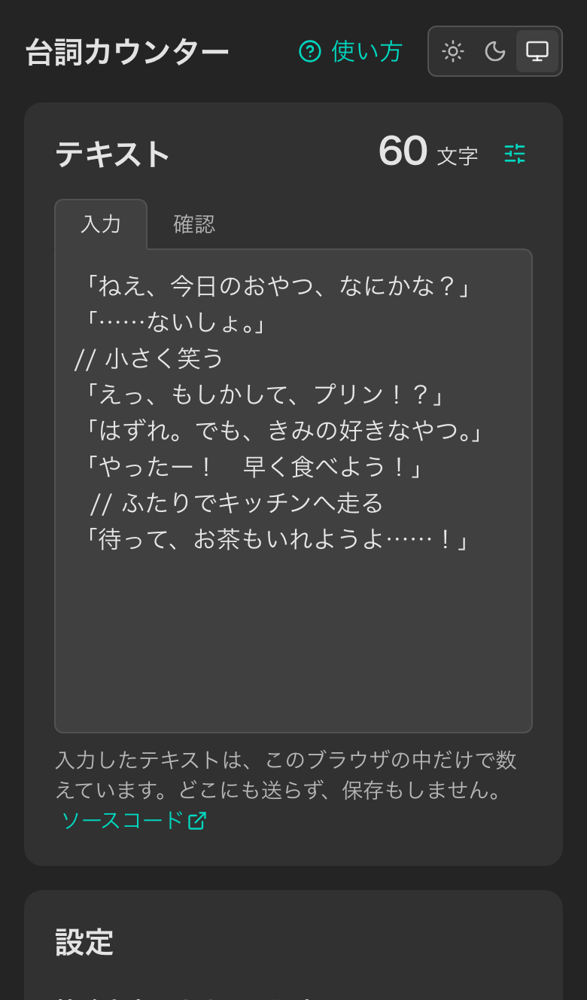

# 台詞カウンター

台本などの台詞の文字数を、除外ルール（記号・空白・コメント行など）を設定したうえで、リアルタイムに数える Web アプリです。

https://dialogue-counter.web.app/

<p>
  
  
</p>

## 機能

- テキストを入力・貼り付けすると、文字数をすぐに数え直す。文字数はスクロールしても画面の上に残る
- 空白・改行を数えるかを切り替えられる
- 数えない文字（`、` `。` `「` `」` など）を登録できる
- 指定した文字で始まる行（`//` で始まるメモの行など）を、まるごと数えない
- 「入力」と「確認」を切り替えられる。「確認」では、数えない文字・行・空白・改行を薄くして、どこが数えられていないかを見せる
- 登録した文字は、削除したあと数秒のあいだ「元に戻す」で戻せる
- ライト・ダーク・OS に合わせる、からテーマを選べる
- 設定とテーマはブラウザ（localStorage）に保存する。入力したテキストは保存しない
- 入力したテキストは、どこにも送らない。そのことを使い方とテキストの入力欄の下に書き、公開するページには CSP の `connect-src 'none'`（`firebase.json`）を付けて、ブラウザに通信を止めさせている
- PC では横に2列、スマホでは縦に並べる。キーボードだけでもすべての操作ができる

## 技術スタック

- React 19 / TypeScript 7 / Vite 8
- Tailwind CSS v4 / Headless UI / class-variance-authority / lucide-react
- BIZ UDゴシック（`@fontsource/biz-udgothic`。登録した値を表示する、日本語の等幅フォント）
- zustand（状態と保存）
- react-hook-form / Zod（`zod/mini`。フォームの検証とドメインの値）
- Vitest（単体テスト）/ Playwright（E2E）
- Biome（lint / format）
- GitHub Actions（CI）/ Firebase Hosting（公開）

## 設計

### 数え方

- 1文字は、見た目の1文字（書記素。`Intl.Segmenter`）として数える。絵文字や結合文字も1文字になる
- 「空白」は、改行以外の空白（半角・全角スペース、タブなど）
- 行の先頭文字は、行頭のスペースやタブを読み飛ばして判定する（インデントした行も対象になる）
- 数えない文字・行・空白・改行は、どれも元のテキストの上で探し、見つかった範囲をすべて合わせて数えない。取り除いた結果くっついてできた並びは数え、別の数えない文字と重なる範囲は数えない

仕様は `src/features/counter/domain/countRule.test.ts` に、テストとして書いてあります。

### ディレクトリと依存の向き

```
src/
  app/        エントリーポイントとグローバルな CSS
  pages/      画面（部品を並べるだけ）
  features/
    counter/  文字数を数える機能
      domain/      数え方のルール（Zod の schema と純粋関数。画面やストアを知らない）
      stores/      ルールの状態と保存（zustand）
      components/  機能の画面の部品
    theme/    テーマの切り替え
  shared/     機能に依存しない汎用のもの（ui / hooks / lib）
```

依存は外側から内側への一方向にしています（`app` → `pages` → `features` → `shared`、機能の中では `components` → `stores` → `domain`）。この向きは、Biome の `noRestrictedImports`（`biome.json`）で lint のエラーにしています。

### 状態と保存

- ルールの値（`RuleValue`）は、Zod の brand 付きの schema で表す。空や空白だけの文字列は、この型にならない
- 保存データは、読み込むときに schema で検証し、壊れていれば初期値に戻す
- ストアは保存先を受け取る関数で作り、テストではメモリの保存先を渡す

### テーマ

- 色は `@theme` のトークンに `light-dark(ライト, ダーク)` で書き、`color-scheme` で切り替える。普段は OS に合わせ、`<html data-theme>` で上書きする
- 保存したテーマは、`index.html` の小さなスクリプトが描画の前に付ける。React が読み込むまで OS のテーマで表示される、ちらつきを防ぐため
- 切り替えと削除のアニメーションには View Transitions API を使う。対応していないブラウザや、OS で動きを減らす設定のときは、アニメーションなしで切り替わる

### アクセシビリティ

- ボタンや入力欄には、読み上げで用途がわかる名前を付ける（アイコンだけのボタンは、`aria-label` を型で必須にしている）
- エラーは入力欄に結び付け（`aria-describedby` / `aria-invalid`）、表示したときに読み上げる
- 削除したあとは、隣の項目にフォーカスを移す。取り消しの通知は `role="status"` で読み上げる
- フォーカスの枠は `:focus-visible` でそろえる

## サプライチェーン対策

- 公開されてから 7 日たっていない版は入れない（pnpm の `minimumReleaseAge` と、Dependabot の `cooldown`）
- 依存のビルドスクリプトは実行しない（pnpm の既定）。CI では lockfile のとおりにだけ入れる（`--frozen-lockfile`）
- CI のアクションはコミット SHA で、OS・mise・firebase-tools は版で固定する。workflow の権限は、読み取りを既定にする
- Dependabot の PR は、自動ではマージしない

## 開発

```bash
mise install
pnpm install
pnpm dev
```

準備・コマンド・テストの方針・CI・依存の更新の手順は、[CONTRIBUTING.md](CONTRIBUTING.md) にまとめています。
